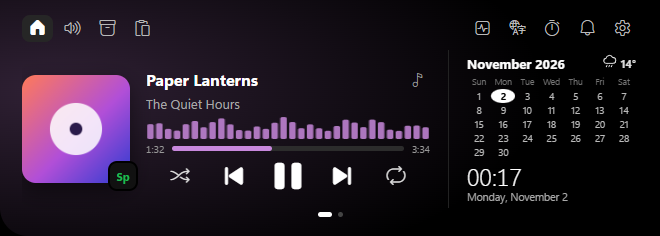
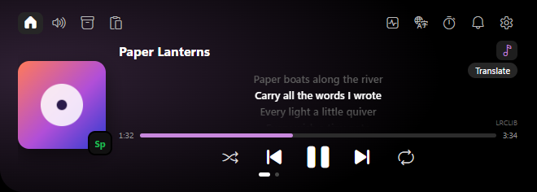
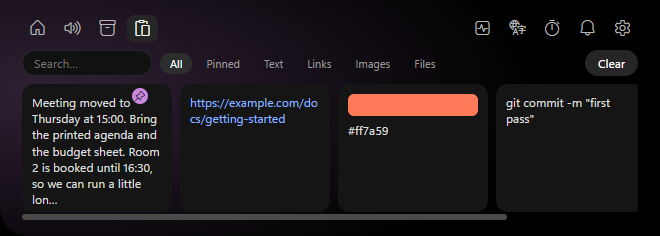
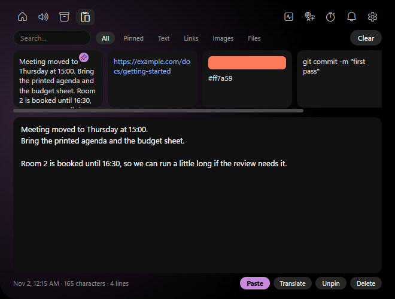
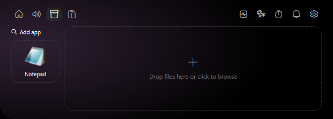
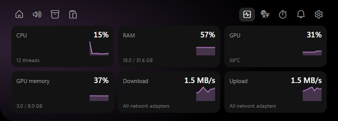
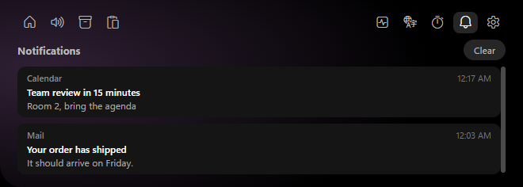
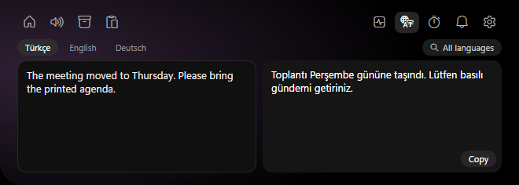

# DynIsland

A dynamic island for Windows, built with Tauri. It sits at the top of the screen as a thin line, stays above other apps, and takes up no desktop space. Touch the line with the mouse and it opens.



The idea comes from [Skerry](https://github.com/Casellus/Skerry). DynIsland is a separate project with its own code and is not affiliated with it.

## Install

Download `DynIsland-Setup-0.1.2.exe` from [Releases](https://github.com/Lowell137/dynisland/releases) and run it. It installs for your user only and does not ask for admin rights. If you would rather not install anything, the same page has a standalone `dynisland.exe`.

The app is not code signed, so Windows SmartScreen may warn you the first time. Choose "More info", then "Run anyway".

DynIsland needs the WebView2 runtime, which comes with Windows 11. It has only been tested on Windows 11.

## What it does

### Music

The island shows whatever is playing in any app that reports to Windows media controls, with album art, a seek bar and play, skip, shuffle and repeat buttons. The accent color comes from the album art. System volume is in the header.

The note icon swaps the calendar for lyrics. Synced lyrics follow the song, and clicking a line jumps there. They can be translated line by line.



### Clipboard

History keeps text, links, images and files. Clicking an item pastes it into the app you were using.



Rest the mouse on an item and the island grows downward to show it in full. You can pin items, search them and filter by type. Pinned images are saved to disk and survive a restart; other images are lost when the app closes.



`Ctrl+Alt+V` opens the clipboard from anywhere. Arrow keys move, Enter pastes, Space previews and Esc closes. You can change the shortcut in Settings.

Content that password managers mark as private is skipped, and history can be paused.

### Shelf

Drop files on the island to keep them handy, then drag them out when you need them. Dropping a file on a quick app opens it with that app. "Add app" lists your installed apps with search, or you can browse for an `.exe`.



### System monitor

CPU, RAM, GPU, GPU memory, download and upload, each with a small graph. GPU figures need an NVIDIA card.



### Notifications

Windows notifications show up in the island and collect in a list. Clicking one opens the app that sent it, or the link the notification carries. Windows still shows its own notification too, and buttons inside a notification, such as reply, are not available.



### Translate

Type or paste text and pick from 133 languages with search. Google works without setup. DeepL needs your own API key, which goes in Settings.



### The rest

A calendar, a clock and the weather, a timer and stopwatch that can stay visible on the closed island, and quick notes. The interface is available in English and Turkish.

## What leaves your PC

| Feature | Sent to | What is sent |
| --- | --- | --- |
| Lyrics | LRCLIB, NetEase, Genius, lyrics.ovh | Title and artist of the current track |
| Translate | Google or DeepL | The text you translate |
| Weather | Open-Meteo | Your city or coordinates |

Clipboard history and notifications stay on your PC. Notifications are read from the database Windows keeps for your user account. Genius and NetEase have no public lyrics API for this, and Google's free translation endpoint is unofficial, so any of them could stop working.

## Build from source

You need Rust, the MSVC build tools and, for the installer, [Inno Setup 6](https://jrsoftware.org/isinfo.php).

```bash
cd src-tauri
cargo build --release
```

`installer/dynisland.iss` expects the exe in `C:\dyn-target\release`, so either set `CARGO_TARGET_DIR=C:\dyn-target` or change `BuildDir` at the top of the script. Then compile it:

```bash
ISCC installer/dynisland.iss
```
